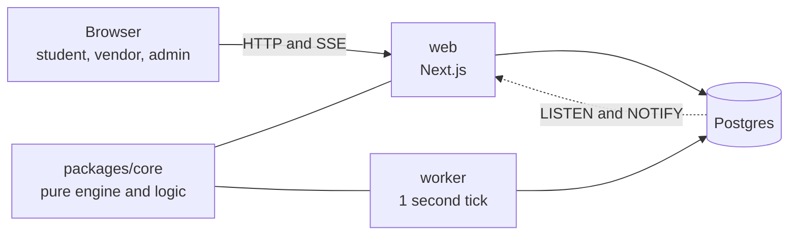

# UniBowl

[](https://github.com/HaniaaKhann/BUCHACK-2.0/actions/workflows/ci.yml)

**Food that fits your diet, ready before your next class.** UniBowl shows every HKBU canteen in one place, filters by diet and allergen using only tags an outlet owner has confirmed, and gives a wait range instead of one fixed promise, so students with a short break can pick something that will be ready in time. Pickup only, no delivery.

Demo video: `https://youtu.be/yOGazbse6U8`

> **Demo data.** Outlet names and hours are from HKBU's public pages. Menus, prices and wait times are simulated, and wallet money is demo money. Not affiliated with HKBU Estates Office or its caterers.

## The problem

Students have short breaks between classes. They do not know which canteen has food that fits their diet, budget and time, and campus ordering apps promise ready times that do not always hold. Two reports, both from student newspapers:

- **UCLA.** The Daily Bruin reported that a student had to leave or give away his order several times because the ready time fell during his class. UCLA Dining blamed algorithm issues in the app (Transact Mobile), plus order volume and staffing. [Source](https://dailybruin.com/post/students-air-frustrations-with-ucla-dinings-switch-to-mobile-ordering)
- **NYU.** Washington Square News reported unreliable Grubhub pickup times, with waits of up to two hours reported at peak. [Source](https://nyunews.com/opinion/2023/03/10/awful-wait-times-nyu-eats)

These are reports from other campuses, not measurements of HKBU.

We have not run a student survey yet, so no student numbers are claimed.

## What it does today

**Students**

- Sign up with nothing required. Diet and allergen filters, a health goal and the chat language are optional. Adding classes is optional too: the day, start, end and building of each class stay on the profile until the student edits or deletes them, and never the course name. Choosing where you are ("From") is a selector in the filter panel; without it the list still shows, with the class start time and a hint instead of a leave time.
- One ranked list of dishes from all HKBU outlets, with a wait **range**, whether it fits before the next class, and when to leave. Filters for price, wait, "fits before my next class", open now, outlet and sort order, in a bottom sheet on phones and a collapsible column on laptops.
- Diet and allergen filters use only tags an outlet owner has confirmed, so with a filter on, unconfirmed dishes are left out, and halal is never assumed. Tiles show ticks and **Not verified** only while a diet or allergen filter is active.
- Order as soon as ready or for a 15-minute pickup slot, pay from a demo wallet (the checkout shows the credit before and after the order), follow the order live, cancel while the order is still waiting to be accepted (at most the first minute), and tap **I picked it up** when they have it. An order nobody taps completes by itself 30 minutes after it was ready, on the demo clock.
- A bell with an unread count for order updates and a leave-now reminder, and a short "Added to cart" message with a View cart button when a dish is added.
- A chat assistant in English, Traditional Chinese and Simplified Chinese. It answers only from the app's own data (open outlets, waits, what fits before class, diet and allergen filters, order status, wallet, when to leave, how to order). It follows simple rules (no model, no network call, no key) and copes with typos and many ways of asking, for example "wallt", "noodels" or "hallal food". When it fixes a diet or allergen word it says "I read this as halal" first and never calls a dish safe on a loose match, and when it is unsure which allergen is meant it asks instead of guessing. When it cannot match a question it says so and shows four example questions to tap. It cannot filter by spice, it never calls a dish halal unless an owner confirmed it, and nothing a student types is stored or sent anywhere. See [`docs/CHATBOT.md`](docs/CHATBOT.md).
- Delete their own account, with a confirm step.

**Vendors**

- A live order board (New, Accepted, Preparing) with one button per step. **Mark ready** is the last step: the order leaves the board and shows under **Done today** as waiting for pickup, then completed once the student taps or 30 demo minutes pass. A sound alert plays for new orders.
- Busy level, pause orders, and a stock switch per dish.
- The owner can add a dish, edit its name, price and category, and confirm its diet and allergen tags. Staff cannot.
- The owner has a sales page for their own outlet: order history (today or the last 7 days), revenue, orders and average order value for today, the top 5 dishes and orders per hour as bars with a text table. Staff see the order board and Done today only. In the demo the page also shows clearly labelled **Sample data for the demo** for the last 7 days, stored apart from real orders and never used by the wait-time engine.

**Admin and demo tools**

- A demo clock: pause, speed up, jump forward, set a time, or go back to the demo start.
- An accuracy page with the backtest results below.
- `pnpm demo:reset` and `pnpm demo:reset:ready` return the demo to a known starting state.

**Design**

- One five-colour theme in a single file, with every text colour pair tested for WCAG AA contrast, and light CSS motion (tiles fade in, cards react to the pointer, the cart count bumps, the landing page fades in) that switches off for people who ask their device for reduced motion. Details are in [`docs/THEME.md`](docs/THEME.md).

## How it differs

|                                                         | Grubhub                                             | Transact                                                                                                               | Plain campus ordering (example: HKBU's QR pre-order) | UniBowl                                                    |
| ------------------------------------------------------- | --------------------------------------------------- | ---------------------------------------------------------------------------------------------------------------------- | ---------------------------------------------------- | ---------------------------------------------------------- |
| Ready-time problems reported by students in our sources | Yes: NYU, waits of up to two hours reported at peak | Yes: UCLA, a pickup time fell during a student's class and UCLA Dining blamed the app's algorithm, volume and staffing | Not reported                                         | Not measured on real students yet                          |
| How the ready time is shown                             | Not reported                                        | Not reported                                                                                                           | A fixed promise: "ready in just 5-10 minutes"        | A range, from the queue state and learned outcomes         |
| Knows your timetable                                    | Not reported                                        | Not reported                                                                                                           | Not reported                                         | Yes, from the free gaps you enter                          |
| Diet and allergen filter across all outlets             | Not reported                                        | Not reported                                                                                                           | Not reported                                         | Yes, with confirmed tags only                              |
| Tags confirmed by the outlet owner                      | Not reported                                        | Not reported                                                                                                           | Not reported                                         | Yes, only an owner can confirm                             |
| Every campus outlet in one list                         | Not reported                                        | Not reported                                                                                                           | Not reported                                         | Yes: the 12 HKBU outlets we seeded (11 take pickup orders) |
| Works with an outlet's existing ordering system         | Not applicable                                      | Not applicable                                                                                                         | Not applicable                                       | Not yet (see the Roadmap)                                  |

"Not reported" means the sources we cite say nothing about it. It does not mean the product lacks the feature, and we did not test the other products. The HKBU entry rests on [HKBU's archived catering promotions page](https://eo.hkbu.edu.hk/eo-services/services-facilities/Catering-Services/archived-promotions.html), which announces scan-a-QR-code pre-ordering at BU Fiesta, with online payment by Alipay and WeChat Pay, and says "Your order will be ready in just 5-10 minutes".

## How the wait estimate works

For each outlet the engine tracks a queue: how many orders are waiting, how fast the kitchen clears them, and how long a dish takes to cook. The estimate is `queue delay + prep time`, shown as a range built from how wrong earlier estimates were. When an order is marked Ready, the difference between the estimate and what happened feeds back in, so the engine corrects its own bias and range. A vendor's busy level scales expected demand, with hand-set multipliers.

All of the engine's history is simulated, so the learning is only validated on simulated data. The full formulas, the fallback chain, a worked example, the list of deviations from a textbook design and the known limits are in [`docs/WAIT_TIME_ENGINE.md`](docs/WAIT_TIME_ENGINE.md).

## Accuracy

> **These numbers come from simulated data, not real canteen measurements.** A fixed-seed generator produced six weeks of walk-ins, kitchen behaviour and staff taps for the outlets. Three models were run forward in time, using only data known at the moment of each prediction: weeks 1 to 4 warm them up, and weeks 5 and 6 are scored. There are no real measurements yet, so how well this holds for real students is unknown.

"Mean error" is the average gap in minutes between the point estimate and what happened. "Inside the range" is the share of orders whose real time fell inside the shown range (a perfect 80 percent range would score 80). Source: [`apps/web/public/accuracy.json`](apps/web/public/accuracy.json), shown at `/admin/accuracy`.

**Against the true ready time** (1,785 test orders)

| Model                              | Orders | Mean error (min) | Inside the range |
| ---------------------------------- | ------ | ---------------- | ---------------- |
| Historical only                    | 1785   | 4.86             | 61.5%            |
| Historical + backlog walk-in model | 1785   | 7.59             | 39.1%            |
| Full model with in-app learning    | 1785   | 3.91             | 73.4%            |

**Against the vendor Ready tap** (1,609 test orders with a tap)

| Model                              | Orders | Mean error (min) | Inside the range |
| ---------------------------------- | ------ | ---------------- | ---------------- |
| Historical only                    | 1609   | 4.75             | 67.2%            |
| Historical + backlog walk-in model | 1609   | 7.77             | 33.4%            |
| Full model with in-app learning    | 1609   | 3.84             | 77.2%            |

**By week type, against the true ready time**

| Week          | Model                              | Orders | Mean error (min) | Inside the range |
| ------------- | ---------------------------------- | ------ | ---------------- | ---------------- |
| Exam week     | Historical only                    | 723    | 3.69             | 66.3%            |
| Exam week     | Historical + backlog walk-in model | 723    | 4.57             | 44.4%            |
| Exam week     | Full model with in-app learning    | 723    | 3.04             | 77.5%            |
| Teaching week | Historical only                    | 1062   | 5.65             | 58.2%            |
| Teaching week | Historical + backlog walk-in model | 1062   | 9.65             | 35.5%            |
| Teaching week | Full model with in-app learning    | 1062   | 4.50             | 70.7%            |

The full model is the most accurate of the three, but its range is narrower than its 80 percent target. The middle model is worse than history alone, because its capacity estimate is too low. The exam week had no earlier exam week to learn from. The limits are listed in the engine doc. The admin accuracy page also has a panel for real orders placed in the app: it shows an empty state until there are completed orders, and has no figures of its own.

## Architecture



One web process, one worker and one Postgres. No Redis and no external service. Details, including the order flow and realtime, are in [`docs/ARCHITECTURE.md`](docs/ARCHITECTURE.md).

## Run it

Prerequisites: Docker.

```
docker compose up
```

The first start builds the images, so it takes a few minutes. Then open http://localhost:3000.

The database is not published on the host, so it never clashes with a local Postgres. To reach it from the host, pick a free port: `DB_HOST_PORT=55432 docker compose -f docker-compose.yml -f docker-compose.db-port.yml up`.

`docker compose up` runs everything with `DEMO_MODE=true` (set for the setup, web and worker services in `docker-compose.yml`). Demo mode seeds the demo accounts and the simulated history, and it is the only mode where the admin can change the clock.

### Demo accounts

All four use the password `demo-password-1`. These are demo logins only, with no real credentials.

| Email                  | Role                       | Lands on                                                   |
| ---------------------- | -------------------------- | ---------------------------------------------------------- |
| `student@demo.example` | student                    | the home screen (onboarding first, if there is no profile) |
| `owner@demo.example`   | vendor owner of Bistro NTT | `/vendor`                                                  |
| `staff@demo.example`   | vendor staff of Bistro NTT | `/vendor`                                                  |
| `admin@demo.example`   | admin                      | `/admin`                                                   |

The four demo accounts cannot be deleted. Create your own account to try deleting one.

### Demo tools

The admin page at `/admin` has the demo clock (speed, jump forward, set a time) and `/admin/accuracy` has the backtest. The student home screen has the bell and the chat assistant.

To return a running demo to its starting state (fixed clock at 12:15 on Tuesday 17 November 2026, no orders, seeded stock and tags, wallet back to HK$300), run `pnpm demo:reset` with `DEMO_MODE=true` and `DATABASE_URL` set. On a fresh clone, run `pnpm install` and `pnpm --filter @app/db prisma:generate` first, or the command fails because the Prisma client does not exist yet. It leaves the demo student not onboarded, so the first sign-in shows onboarding.

For quick retakes, run `pnpm demo:reset:ready` instead. It does the same reset and also leaves the demo student onboarded with a profile: English chat, standing at the Bistro NTT building, no diet or allergen filters. The waits are identical in both modes; each run prints the same wait fingerprint and a state fingerprint that also covers the student.

Before recording the video, run `pnpm demo:reset`. With the Docker stack that is `docker compose exec worker ./node_modules/.bin/tsx src/demoResetCli.ts` (add `--ready` for the second mode).

## Development and tests

Prerequisites: Node 22+, pnpm 9+, Docker (for Postgres).

```
pnpm install
pnpm --filter @app/db prisma:generate
pnpm lint
pnpm typecheck
pnpm test
pnpm build
```

### End-to-end and database tests

`test:e2e` needs the whole Docker stack running (`docker compose up -d --build`) and a browser, so it is not part of CI; it was proven stable on a local machine (five runs in a row). `test:db` needs only Postgres at `DATABASE_URL`, and CI runs it after the unit tests.

```
pnpm test:e2e
pnpm --filter @app/worker test:db
```

`pnpm test:e2e` runs the Playwright specs in `tests/e2e`: the student happy path (filter, add to cart, order, then the vendor moves it through Accepted, Preparing and Ready, it appears under Done today, the student taps I picked it up, and the bell fills), the owner's sales page and staff access to it, account deletion and the owner's menu editing at 1280 and 390 pixels, and an overflow sweep of every page at 1280, 768 and 390 pixels using the longest outlet name. It resets the demo before it starts and again when it ends, even if a test fails, so the stack is left in the demo state. It reaches the database through `docker compose exec`; set `E2E_COMPOSE_ARGS` (for example `-p name`) and `E2E_COMPOSE_DIR` if your stack is not the default one in the current folder. Set `PLAYWRIGHT_CHANNEL=msedge` or `chrome` to use an installed browser, or run `pnpm exec playwright install chromium` once. `E2E_VENDOR_SWAP=0` skips the part of the sweep that temporarily gives the demo owner the vendor with the longest name.

`pnpm --filter @app/worker test:db` runs the database tests against `DATABASE_URL`: the demo reset, a scheduled order starting at its `fire_at` through the worker loop, and the worker's notifications.

## Data sources

- **Real:** outlet names, campus, building, floor, opening hours and official dietary options, the building list and the 2026-27 academic calendar. Each outlet row carries its source link and the date it was retrieved. See [`docs/DATA.md`](docs/DATA.md).
- **Estimated:** walking times between buildings. The app marks them "est.".
- **Simulated:** every menu and price, ticket count, order and wait time, and the six weeks of history the engine learns from. Menus are hand-written for the demo. An importer for the Kaggle dataset "Uber Eats USA Restaurants and Menus" exists, but it has not been run on the real files, so no Kaggle data is in the demo.
- **Demo shortcut:** in demo mode the seed marks the menus of three outlets (Bistro NTT, Main Canteen, Harmony Cafeteria) as confirmed by the demo owner, so the tick and the filters can be shown. All other outlets stay Not verified, and halal is never seeded.
- HKBU's caterer brand names, logos and photos are not used. The outlet photos and the logo are our own, taken on campus (see [`docs/THEME.md`](docs/THEME.md) for the file names).

## Privacy

The app stores a student's building choice, diet and allergen filters, goal, chat language, optional classes (day, start, end and building, never the course name) and the free gaps worked out from them, plus orders, a demo wallet and notifications. It stores no GPS, camera data or course names. The chat stores nothing. Vendors see items, totals and times for their own outlet but not which student ordered. There are no third-party calls. Students can delete their account, which deletes their profile, classes, free gaps, notifications, wallet and all of their orders. Every stored field, why it is kept and for how long is in [`docs/PRIVACY.md`](docs/PRIVACY.md).

## Documentation

[`ARCHITECTURE`](docs/ARCHITECTURE.md), [`WAIT_TIME_ENGINE`](docs/WAIT_TIME_ENGINE.md), [`PRIVACY`](docs/PRIVACY.md), [`API`](docs/API.md), [`AUTH`](docs/AUTH.md), [`DATA`](docs/DATA.md), [`VENDOR_ONBOARDING`](docs/VENDOR_ONBOARDING.md), [`THEME`](docs/THEME.md), [`CHATBOT`](docs/CHATBOT.md).

## Theme

Theme: data driven apps. UniBowl combines canteen ticket counts, order timestamps and students' free class windows to predict a ready time range, and it corrects itself from real order outcomes (shown on simulated data for now).

## Roadmap

Not built, so not part of the features above:

- Menu photo import, platform sync with outlets' existing ordering systems (`PlatformAdapter` is an interface only), promotions, rewards, deeper vendor insights beyond the sales page, web push, and "back in stock" notifications.
- Timetable integration with HKBU's own systems, and anonymous people counting with no faces stored.
- Real payments instead of the demo wallet, and more campuses.
- Vendor sign-up and adding staff in the app, deleting a dish, setting pickup-slot capacity, importing stopwatch samples, and a data export.
- Real measurements of ready times, to replace the simulated history. The first step is a real canteen stopwatch sample at an HKBU outlet, which would also give the first honest accuracy figures.

## Team

Team ByteNBite, four members: Hania Khan, Moiz Ahmed, Dania Asad and Maryam Noor.

## License

MIT. See [`LICENSE`](LICENSE).
