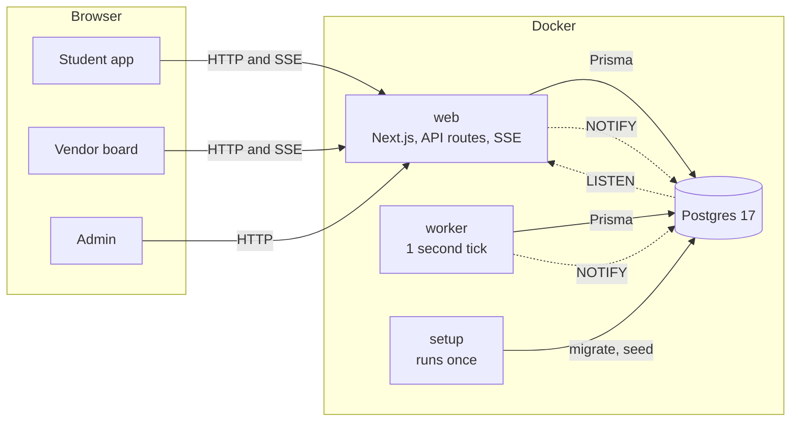
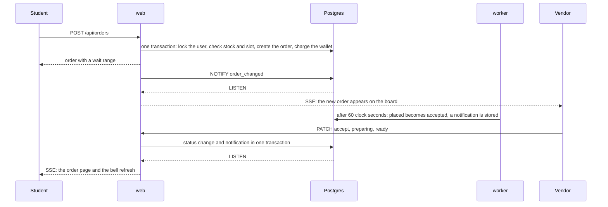
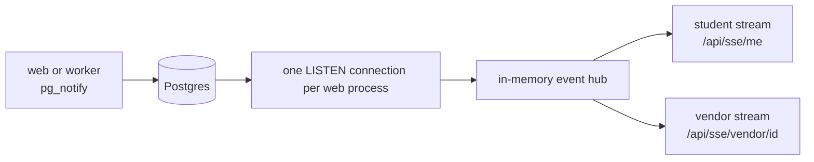

# Architecture

## The big picture



One web process, one worker and one database. There is no Redis, no queue and no external service. `docker compose up` starts `db`, waits for it to be healthy, runs `setup` to completion, then starts `web` and `worker`.

## Services

| Service  | What it does                                                                                                  |
| -------- | ------------------------------------------------------------------------------------------------------------- |
| `db`     | `postgres:17-alpine`, not published on the host.                                                              |
| `setup`  | Runs once: `prisma migrate deploy`, then, when `DEMO_MODE=true`, builds the simulated history, then the seed. |
| `web`    | The Next.js standalone build on port 3000: pages, API routes and the Server-Sent Events streams.              |
| `worker` | Node TypeScript run with `tsx`: the shared clock, engine snapshots, order jobs and the demo load.             |

## Workspace layout

```
apps/web         Next.js app: student, vendor and admin screens, API, SSE
apps/worker      Background worker, plus the demo reset command
packages/core    Pure functions: engine, ranking, fit, leave-at, slots, chat matcher. No I/O
packages/db      Prisma schema, migrations, seed and seed data, shared queries
packages/integrations  PaymentProvider (mock wallet) and the PlatformAdapter interface
packages/simulator     History generator and the backtest
tests/e2e        Playwright specs (not run in CI)
```

`packages/core` holds the logic and does no database or network work. The web app and the worker fetch data and call it. The simulator never imports the engine except in its backtest, and a test enforces that. `PlatformAdapter` is declared as an interface only; there is no implementation.

## An order, end to end



- **Placing an order** is one database transaction under a per-user advisory lock. It checks the vendor is open, not paused, the items are in stock and any slot has room, creates the order and charges the wallet. If the balance is too low or the slot is full it rolls back (402 or 409). Two simultaneous orders cannot overspend the wallet.
- **The wallet** is a mock behind a `PaymentProvider` interface. There is no balance column: the balance is the sum of `wallet_ledger` rows.
- **Vendor taps** are one-way steps: Accept, Start preparing, Mark ready. Ready is the last one. A repeated tap does nothing, and a tap from the wrong state returns 409. The student completes the order with I picked it up, or the worker does 30 demo minutes after `ready_at`.

## Shared clock

A single `system_clock` row holds the mode (`real` or `demo`), a time and a speed. Everything that needs "now" reads it: demo time is `current_time + (real elapsed since updated_at) × speed`. The worker only reads it. It is written by the seed, by `demo:reset` and by the admin clock page, whose update locks the row in a transaction so simultaneous changes are not lost. Changing the speed re-anchors the time so the clock never jumps.

## Worker

One loop ticks every real second and runs, in order:

1. The demo load, only in demo mode with the clock running: simulated walk-ins and simulated app orders.
2. Engine snapshots for each open vendor at every 15 clock-minutes. After a long jump it replays at most 8 missed boundaries.
3. `autoAccept`: orders still placed after the 60-second grace period become accepted.
4. `slotFire`: accepted scheduled orders become preparing at `fire_at`.
5. `leaveReminder`: a leave-now notification when the clock reaches the predicted ready time minus the walk.
6. `busyExpiry`: a rush state ends 30 clock minutes after it was set.
7. `autoComplete`: a real student's order still `ready` 30 clock minutes after `ready_at` becomes `completed` (the wait is `AUTO_COMPLETE_AFTER_MINUTES` in `packages/core/src/orderLifecycle.ts`). It does not set `picked_up_at` and it skips simulated students, whose orders the demo load finishes.

Each job updates one order at a time, so a worker tick and a vendor tap cannot both create the same notification.

## Engine snapshots

The worker writes one `engine_snapshots` row per vendor per 15 clock-minutes with `model_version`, `computed_at` and a JSON payload: the 8-slot demand forecast, capacity, bias, recent residuals, learned prep, lateness quantiles and the modelled backlog. A live wait is the latest snapshot plus the queue since it. See `WAIT_TIME_ENGINE.md`.

## Realtime



Five channels: `order_changed`, `snapshot_written`, `vendor_changed`, `clock_updated` and `notification_created`. The web process keeps one `LISTEN` connection (reconnecting with backoff and sending a resync) and fans each payload out to the right streams.

- A student stream receives their own order and notification events, plus vendor-level "queue changed" and snapshot events that carry no student data.
- A vendor stream receives only events for that vendor.
- Events carry ids and a status, never items or prices, so clients refetch the details through the normal API. A stream is limited to 5 per user.

## Security

- Server-side access checks on every route: the role, and for vendor routes membership of that vendor (some actions are owner-only).
- `zod` validates every request body, query and path parameter.
- Prisma parameterises every query.
- Better Auth handles sign-in. Passwords are hashed by it, and the session cookie is `httpOnly` with `SameSite=Lax`.
- Rate limiting: an in-memory token bucket limits order placement per user, and Better Auth's built-in limiter protects the auth routes. Both keep counters in process memory, so they reset on restart and are not shared between instances. That is enough for one container.
- The demo-only admin clock refuses changes unless `DEMO_MODE=true`.
- `.env` is gitignored and `.env.example` holds placeholders only. The chat assistant needs no key and makes no external call.
- See `AUTH.md` for roles and `PRIVACY.md` for stored data.

## Stack

| Layer           | Package                   | Version           |
| --------------- | ------------------------- | ----------------- |
| Runtime         | Node                      | 22 (Alpine image) |
| Package manager | pnpm                      | 9.15.0            |
| Language        | TypeScript                | 5.7.2             |
| Web app         | next                      | 15.1.3            |
| UI              | react / react-dom         | 19.0.0            |
| Styling         | tailwindcss               | 3.4.17            |
| Auth            | better-auth               | 1.7.22            |
| Validation      | zod                       | 3.24.1            |
| Database        | PostgreSQL                | 17 (Alpine image) |
| ORM             | prisma / @prisma/client   | 6.1.0             |
| Realtime        | pg                        | 8.13.1            |
| Lint            | eslint, typescript-eslint | 9.17.0, 8.19.0    |
| Format          | prettier                  | 3.4.2             |
| Unit tests      | vitest                    | 2.1.8             |
| Browser tests   | @playwright/test          | 1.65.0            |
| Worker runtime  | tsx                       | 4.19.2            |

Exact versions are pinned in each `package.json`.

## Build and run

- `apps/web` builds with Next.js `output: 'standalone'` for a small Docker image.
- The worker runs from source with `tsx`, because the workspace packages export TypeScript directly. Its check is `pnpm typecheck`, not a build.
- `packages/*` export source TypeScript, and Next transpiles them.

## CI

GitHub Actions `ci.yml` runs, against a Postgres 17 service: install, format check, lint, typecheck, `pnpm test`, the worker database tests (`pnpm --filter @app/worker test:db`) and build. The Playwright specs are not part of CI: they need the whole Docker stack and a browser. Run them with `pnpm test:e2e` (see the README).
