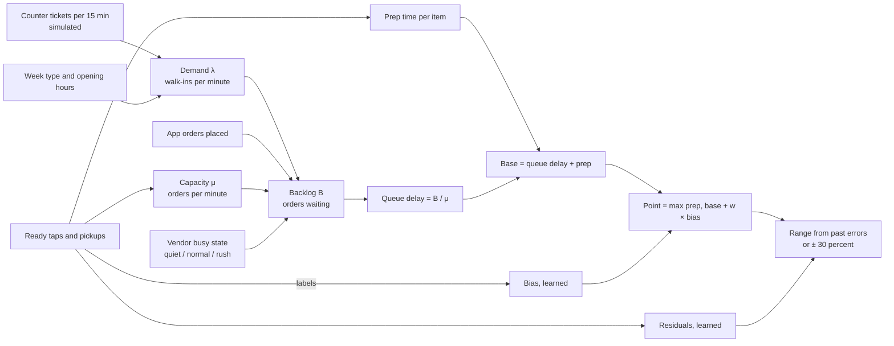

# Wait-time engine

The engine turns "how busy is this kitchen" into a wait **range** for one order, such as "4.8 to 8.9 minutes", and then learns from what actually happened. It is a small queueing model with a few learned corrections, written as pure functions in `packages/core/src/engine/`. The worker stores its state every 15 clock-minutes, and the web app combines that state with the live queue on every request.

Everything it learns from is **simulated** in this demo. There are no real canteen measurements yet. Read the known limits at the end before trusting any number.

## How the pieces fit



## 1. Demand λ: walk-ins per minute

Each outlet's simulated history gives a count of counter tickets for every 15-minute slot. For a slot (weekday, slot of day, week type) λ falls back through three tiers:

| Tier           | Used when                                                                             | λ per minute                                                                                                                                             |
| -------------- | ------------------------------------------------------------------------------------- | -------------------------------------------------------------------------------------------------------------------------------------------------------- |
| Matching weeks | at least 2 earlier weeks have the same weekday, slot and week type                    | recency-weighted mean of walk-ins ÷ 15, newest first, weights 0.4, 0.3, 0.2, 0.1. With 2 or 3 weeks the weights are renormalised over the weeks present. |
| All weekdays   | fewer than 2 matching weeks, but the same slot and week type exists on other weekdays | plain mean over those observations ÷ 15                                                                                                                  |
| Vendor average | nothing else                                                                          | plain mean over all of the outlet's observations ÷ 15 (0 with none)                                                                                      |

Walk-ins are tickets minus app orders in the slot when the outlet's tickets include app orders; in this demo they do not.

The live app does not use a live ticket feed. `lambdaLive` in `lambda.ts` can use "tickets in the last 10 minutes", but only the backtest calls it. After a snapshot the app uses the stored forecast λ scaled by the vendor's busy state (deviation 14 below).

## 2. Capacity μ: orders per minute

- **Prior:** the vendor's own setting if there is one, otherwise the 90th percentile of the per-minute ticket rates over past slots.
- **Learned:** the median number of Ready taps per busy minute.
- **Blend:** `μ = prior + w × (learned − prior)` with `w = n / (n + 30)`, where n is the number of busy minutes seen. With no busy minutes μ is the prior.
- **Floor:** μ is never below 0.05 per minute, so dividing by it is always safe.

A minute is busy when at least one app order has waited longer than its prep prior and has not yet been tapped or picked up. Per slot the rate is `taps in busy minutes ÷ busy minutes ÷ app share`, where app share is app orders ÷ (app orders + tickets).

## 3. Backlog B: orders waiting

Each minute the queue moves by arrivals minus work done:

```
B ← max(0, B + λ + app arrivals − μ)
```

B starts at 0 when an outlet opens. The worker steps it to each 15-minute boundary and stores the result as `backlog` in the snapshot. A live request then continues from the snapshot: it steps minute by minute from the snapshot time to now, using the stored forecast λ for each minute (scaled by the busy state) plus the app orders placed since the snapshot.

## 4. Prep time

- **Per item:** the learned prep if there is one, otherwise the vendor's prior for that item (`prep_prior_min`), otherwise the category prior.
- **Learned prep:** the median placed-to-ready time over at least 5 samples, counting only single-item, quantity-1 orders placed when the backlog was at most 1.
- **Per order:** the longest item plus 0.5 minute for each extra item: `max + 0.5 × (n − 1)`.

A dish an owner adds in the app takes the median prep prior of that outlet's existing dishes (5 minutes if it has none) until enough orders teach the engine its real time.

## 5. The prediction

```
queue delay = B / μ
base        = queue delay + prep
point       = max(prep, base + w_bias × bias)        w_bias = n / (n + 30)
```

The range comes from past prediction errors (`label − point`, the last 200, needing at least 20):

- `low = point + q10` and `high = point + q90` of those errors.
- With fewer than 20 errors the cold-start range is `point × 0.7` to `point × 1.3`.
- Both are floored: `low ≥ 0.5 × prep` and `high ≥ prep`. Then `low ≤ point ≤ high` is forced.

Quantiles use linear interpolation. The app shows the range, rounded outward to whole minutes, never the point alone.

## 6. Learning from outcomes

A **label** is how long an order really took, from placement to the vendor's Ready tap. If there is no tap but there is a pickup, the label is pickup time minus the outlet's median pickup lag, counted at half weight. A label is dropped if it is over 60 minutes or more than 3 times the predicted time. A tap that belongs to a group of 3 or more taps within 10 seconds is counted at half weight, because staff tapping a batch say little about each order.

- **Bias:** an exponentially weighted average of `label − base` with α = 0.2 × the label weight. The first error seeds it.
- **Residuals:** `label − point` for each labelled order, newest 200 kept.
- **Prep and μ:** as described above.

The learning is replayed from the stored orders each time a snapshot is built, so it needs no separate store.

## 7. Scheduled pickup

A student can pick a 15-minute slot instead of "as soon as ready".

- **Earliest slot:** `ceil((now + queue delay + prep) / 15 min)` slots.
- **Start time:** `fire_at = slot start − (forecast queue delay + prep)`. The worker moves the order to Preparing at `fire_at`.
- **Lateness:** the ready time minus the slot start. Its median and 90th percentile (from at least 10 scheduled orders, otherwise 0 and 3 minutes) set the shown range around the slot.
- **Capacity:** `max(1, floor(0.5 × μ × 15))` orders per slot.
- Scheduled orders do not feed the bias or prep learning, because their timing is set by the slot, not by the queue.

## 8. When data is missing: the fallback chain

| Quantity      | First choice               | Then                                                      | Then                                                                    |
| ------------- | -------------------------- | --------------------------------------------------------- | ----------------------------------------------------------------------- |
| λ             | matching weeks             | same slot on all weekdays                                 | vendor average                                                          |
| μ             | prior blended with learned | prior alone                                               | floor 0.05                                                              |
| Prep per item | learned                    | vendor prior                                              | category prior                                                          |
| Range         | residual quantiles         | ± 30 percent                                              | floored at 0.5 × prep and prep                                          |
| Snapshot      | latest at or before now    | none yet: the wait is the prep time alone, flagged `cold` | a snapshot written before `backlog` existed: backlog 0, flagged `stale` |

## 9. Worked example, with the demo's real numbers

Main Canteen at the demo start (Tuesday 17 November 2026, 12:15 Hong Kong time), straight from the seeded snapshot:

| Quantity                      | Value                                        | Where it comes from                     |
| ----------------------------- | -------------------------------------------- | --------------------------------------- |
| λ for the 12:15 slot          | 0.62 per minute (9.3 walk-ins in 15 minutes) | matching weeks                          |
| μ                             | 0.60 per minute                              | prior only: no busy minutes learned yet |
| Backlog B at 12:15            | 0.50                                         | stepped from opening                    |
| Median prep prior of the menu | 6 minutes                                    | menu priors                             |
| Bias                          | none                                         | 0 labelled orders                       |
| Residuals                     | none                                         | so the cold-start range applies         |

1. Queue delay = 0.50 ÷ 0.60 = 0.83 minutes.
2. Base = 0.83 + 6 = 6.83 minutes.
3. Point = max(6, 6.83 + 0 × 0) = 6.83 minutes.
4. Range: low = max(0.5 × 6, 0.7 × 6.83) = max(3, 4.78) = 4.78. High = max(6, 1.3 × 6.83) = max(6, 8.88) = 8.88.

The app shows this as **4 to 9 minutes** (4.78 and 8.88 rounded outward), and `pnpm demo:reset` prints it as "4.8 to 8.9 min (point 6.8)".

## 10. Deviations from the simple design

Each of these is a choice the code makes that a textbook version would not. The file is under `packages/core/` unless stated.

1. **Weights over fewer weeks are renormalised** (`lambda.ts`), so two matching weeks still sum to 1.
2. **μ has a floor of 0.05** (`config.ts`, `mu.ts`) so `B / μ` never divides by zero.
3. **Learned μ is the median** of per-busy-minute tap counts, not the mean (`mu.ts`).
4. **The first bias error seeds the average** instead of starting from 0 (`bias.ts`).
5. **Point floor:** `point = max(prep, …)` so a negative bias can never promise less than the cook time (`predict.ts`).
6. **Range clamp:** `low ≤ point ≤ high` is forced, which matters when all past errors have the same sign (`predict.ts`).
7. **Range floor (model version v2):** `low ≥ 0.5 × prep` and `high ≥ prep`, for both the residual range and the cold-start range. The first version floored the low end at the full prep time. In the backtest that put about 60 percent of full-model test orders below their own range, because simulated true cook time is often under the menu prior (`quantiles.ts`).
8. **Residual window is the last 200 entries** of the list passed in, oldest first (`quantiles.ts`).
9. **The fallback label always has weight 0.5**, and the batch-tap weight does not apply to it (`label.ts`).
10. **A batch tap** is any order in a run of 3 consecutive Ready taps spanning 10 seconds or less (`label.ts`).
11. **Slot capacity has a floor of 1**: the plain formula gives 0 when μ is below about 0.13 per minute, and then nothing could be booked (`slots.ts`).
12. **Week types** are teaching, reading, exam and holiday. A day outside the stored calendar counts as teaching.
13. **The snapshot stores the modelled backlog** (`backlog`), so a live request does not rebuild the day. A snapshot without it is treated as stale.
14. **Busy multiplier (hand-set, not learned).** The outlet's busy state scales λ after the snapshot: ×0.6 when quiet, ×1.0 when normal, ×1.6 when rush. The stored backlog is never rescaled. A rush expires 30 clock minutes after it is set, and an expired rush counts as normal. It applies to the live wait in the web app and to the demo load in the worker (`engine/liveWait.ts`, `apps/web/src/server/waitEstimate.ts`).
15. **Not built:** the extra delay for uncommon items, and any live counter-ticket feed in the app.

## 11. Known limits

- **All history is simulated.** The generator uses a fixed seed and hand-set demand, kitchen and tap behaviour. The numbers it calibrated to (for example a Main Canteen median true wait near 9.5 minutes) were set once for plausibility and not tuned against backtest results. Real accuracy is unknown until real measurements exist.
- **Accuracy is below the nominal 80 percent.** The range is q10 to q90, so about 80 percent of orders should land inside it. The full model gets 73.4 percent against the true ready time and 77.2 against the staff tap.
- **The capacity prior measures demand, not throughput.** It is the 90th percentile of ticket rates, which understates the real kitchen capacity (in the simulation the Main Canteen prior is about 0.6 per minute against a simulated capacity of about 1.3). That overstates queue delays, which is why the "history plus backlog" model is worse than "history only" in the backtest.
- **Learning is weak when few orders come from the app.** In the simulation 15 percent of orders are app orders, so learned capacity is noisy.
- **The exam week is unseen in training.** The backtest's exam week has no exam week before it, so its demand falls back to the vendor average.
- **The calendar and the simulator disagree.** The simulator uses an agreed layout (week 3 holiday, week 5 exam) while the stored calendar has those weeks as teaching, so the worker treats them as teaching and λ for teaching slots is slightly low.
- **The busy multiplier is a guess.** It is a hand-set rule, not something the data taught.
- **Class break times in the simulator are an assumption**, not taken from HKBU timetables.
- **Scheduled orders are not backtested.** The simulated history has none, so the lateness figures come only from the cold-start defaults until real scheduled orders exist.

## Where the code is

| What                           | Where                                                                          |
| ------------------------------ | ------------------------------------------------------------------------------ |
| Formulas                       | `packages/core/src/engine/`                                                    |
| Constants                      | `packages/core/src/config.ts`                                                  |
| Snapshot builder               | `apps/worker/src/jobs/engineSnapshot.ts`, `apps/worker/src/snapshotPayload.ts` |
| Live wait                      | `packages/core/src/engine/liveWait.ts`, `apps/web/src/server/waitEstimate.ts`  |
| History generator and backtest | `packages/simulator/`                                                          |
| Backtest results               | `apps/web/public/accuracy.json`, shown at `/admin/accuracy`                    |
